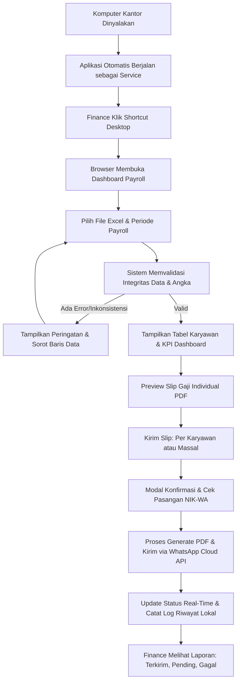
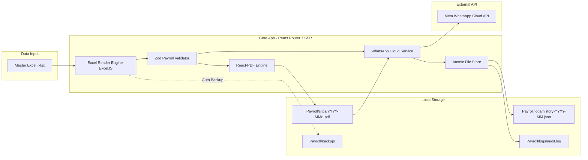

# PRODUCT REQUIREMENT DOCUMENT (PRD)

## Sistem Payroll Management & WhatsApp Payslip Distribution
**Versi:** 1.0.0  
**Tanggal:** 2 November 2026  
**Status:** Approved for Implementation  
**Target Pengguna:** Tim Finance & Payroll Perusahaan/Instansi  
**Prinsip Arsitektur Utama:** **Database-Free (Excel as Single Source of Truth), Local-First, Zero-Cloud Data Storage (kecuali Meta WhatsApp Cloud API)**

---

## 1. Ringkasan Eksekutif & Latar Belakang

### 1.1 Latar Belakang
Bagian Finance setiap bulannya menghadapi proses distribusi slip gaji karyawan yang memakan waktu, rawan kesalahan manual (*human error*), dan berisiko kebocoran data jika slip gaji fisik atau dokumen PDF tertukar. Solusi berbasis ERP/SaaS cloud pihak ketiga sering kali terlalu mahal, membutuhkan migrasi database rumit, dan menimbulkan kekhawatiran atas privasi data gaji karyawan.

Sebagian besar staf Finance telah terbiasa menyusun dan memvalidasi perhitungan gaji bulanan menggunakan Microsoft Excel. Oleh karena itu, dibutuhkan sebuah aplikasi lokal yang dapat **langsung membaca file Excel payroll yang sudah ada**, memvalidasi integritas data, menghasilkan dokumen PDF slip gaji individual yang rapi dan profesional, serta mendistribusikannya secara otomatis dan terverifikasi ke nomor WhatsApp masing-masing karyawan menggunakan WhatsApp Business Cloud API resmi.

### 1.2 Tujuan Produk
1. **Zero Database Overhead:** Tidak ada ketergantungan pada MySQL, PostgreSQL, SQLite, MongoDB, atau ORM. File Excel adalah satu-satunya data master.
2. **Eliminasi Human Error:** Validasi otomatis keunikan NIK, integritas nomor WhatsApp, dan konsistensi matematika payroll (Gaji Kotor, Total Potongan, Gaji Bersih/THP).
3. **Distribusi Presisi & Aman:** Menjamin PDF slip gaji karyawan A hanya terkirim ke nomor WhatsApp karyawan A berdasarkan baris data yang sama.
4. **Operasional Ramah Non-Teknis:** Staf Finance tidak perlu membuka terminal atau menjalankan perintah teknis. Komputer menyala, aplikasi berjalan otomatis, cukup klik shortcut di desktop dan gunakan antarmuka web berbahasa Indonesia.
5. **Kepatuhan & Arsip Lokal:** Semua arsip PDF dan riwayat pengiriman tersimpan terstruktur di penyimpanan lokal kantor.

---

## 2. Persona Pengguna & Alur Kerja

### 2.1 Persona Pengguna
* **Nama:** Staf Payroll Finance (Non-Teknis)
* **Kebutuhan:** 
  * Ingin mengecek data dari Excel tanpa utak-atik formula lagi.
  * Ingin melihat preview slip sebelum dikirim ke karyawan.
  * Ingin mengirim 100-500 slip gaji dalam beberapa klik dengan progress pengiriman yang jelas.
  * Ingin tahu siapa yang gagal terkirim dan bisa melakukan pengiriman ulang (retry) dengan satu tombol.

### 2.2 User Journey (Alur Kerja Pengguna)


---

## 3. Spesifikasi Data & Struktur Excel

### 3.1 Struktur Kolom Excel Master
Aplikasi membaca langsung file `.xlsx`. Sistem melakukan pencocokan header secara **fleksibel** (case-insensitive, mengabaikan spasi berlebih, dan toleran terhadap variasi penamaan umum) tanpa mengandalkan urutan indeks kolom.

| No | Nama Kolom Standar | Tipe Data | Wajib | Keterangan & Aturan Validasi |
|:---|:---|:---|:---:|:---|
| 1 | `No` | Angka | Opsional | Nomor urut baris |
| 2 | `NIK` | Teks / Angka | **YA** | Kunci identitas unik karyawan. Wajib ada, tidak boleh duplikat. |
| 3 | `Nama Karyawan` | Teks | **YA** | Nama lengkap karyawan. Minimal 2 karakter. |
| 4 | `Departemen` | Teks | **YA** | Unit kerja/divisi (contoh: Operasional, IT, Marketing). |
| 5 | `Jabatan` | Teks | **YA** | Posisi pekerjaan karyawan. |
| 6 | `Status Karyawan` | Teks | Opsional | Tetap, Kontrak, Probation, Magang. |
| 7 | `Hari Kerja` | Angka | Opsional | Total kehadiran dalam hari kerja. |
| 8 | `Gaji Pokok` | Moneter (IDR) | **YA** | Nilai numeric >= 0. |
| 9 | `Tunj. Jabatan` | Moneter (IDR) | Opsional | Nilai numeric >= 0 (default 0 jika kosong). |
| 10 | `Tunj. Transport & Makan` | Moneter (IDR) | Opsional | Nilai numeric >= 0 (default 0 jika kosong). |
| 11 | `Lembur / Insentif` | Moneter (IDR) | Opsional | Nilai numeric >= 0 (default 0 jika kosong). |
| 12 | `Gaji Kotor` | Moneter (IDR) | **YA** | Total penghasilan kotor (harus konsisten dengan penjumlahan komponen). |
| 13 | `BPJS Kes (1%)` | Moneter (IDR) | Opsional | Potongan BPJS Kesehatan. Nilai numeric >= 0. |
| 14 | `BPJS TK (2%)` | Moneter (IDR) | Opsional | Potongan BPJS Ketenagakerjaan. Nilai numeric >= 0. |
| 15 | `PPh 21` | Moneter (IDR) | Opsional | Potongan Pajak Penghasilan. Nilai numeric >= 0. |
| 16 | `Potongan Lain` | Moneter (IDR) | Opsional | Potongan kasbon, keterlambatan, dll. Nilai numeric >= 0. |
| 17 | `Total Potongan` | Moneter (IDR) | **YA** | Total pemotongan (harus konsisten dengan penjumlahan potongan). |
| 18 | `Gaji Bersih (THP)` | Moneter (IDR) | **YA** | Take Home Pay (`Gaji Kotor - Total Potongan`). |
| 19 | `Nomor WhatsApp` | Teks / Angka | **YA** | Nomor HP karyawan untuk pengiriman slip. Dinormalisasi ke format `628xxxxxxxxxx`. |

### 3.2 Aturan Validasi Matematika & Integritas Data
Sebelum slip dibuat atau dikirim, mesin validasi (Zod + Validation Engine) memeriksa:
1. **Keunikan NIK:** Tidak boleh ada 2 baris dengan NIK yang sama pada file Excel.
2. **Normalisasi Nomor Telepon:**
   - Masukan: `081234567890`, `+62 812-3456-7890`, `6281234567890`.
   - Hasil normalisasi: `6281234567890`.
   - Validasi: Panjang 10-15 digit, diawali `628`.
3. **Pemeriksaan Konsistensi Formula:**
   $$\text{Kalkulasi Gaji Kotor} = \text{Gaji Pokok} + \text{Tunj. Jabatan} + \text{Tunj. Transport \& Makan} + \text{Lembur / Insentif}$$
   $$\text{Kalkulasi Total Potongan} = \text{BPJS Kes} + \text{BPJS TK} + \text{PPh 21} + \text{Potongan Lain}$$
   $$\text{Kalkulasi THP} = \text{Gaji Kotor} - \text{Total Potongan}$$
   *Jika terdapat selisih pembulatan atau data di Excel tidak sinkron, sistem menandai baris sebagai **"Peringatan Inkonsistensi"** dan memblokir pengiriman massal pada baris bersangkutan sampai dikonfirmasi atau diperbaiki.*

---

## 4. Arsitektur Sistem & Struktur Direktori

### 4.1 Arsitektur Tanpa Database (File-Based Storage)


### 4.2 Struktur Direktori Penyimpanan Lokal Kantor
Penyimpanan file data terisolasi dan berada di path konfigurasi (misalnya `D:/Payroll/` atau `/home/server100/Payroll/`):
```text
Payroll/
├── data/
│   ├── payroll.xlsx                  # File master Excel aktif
│   └── payroll-template.xlsx         # Template acuan untuk Finance
├── slips/
│   ├── 2026-10/
│   │   ├── Slip_Gaji_100201_2026-10.pdf
│   │   ├── Slip_Gaji_100202_2026-10.pdf
│   │   └── ...
│   └── 2026-11/
├── logs/
│   ├── history-2026-10.json          # Riwayat status WhatsApp per periode
│   ├── history-2026-11.json
│   └── audit.log                     # Catatan aktivitas pengguna & sistem
├── backup/
│   ├── payroll_2026-11-02_135000.xlsx # Snapshot cadangan file Excel saat dibaca
│   └── ...
└── config/
    └── app-settings.json             # Konfigurasi nama perusahaan, kop, template WA
```

### 4.3 Struktur Direktori Proyek Kode (Modular Architecture)
```text
slip-gaji-app/
├── app/
│   ├── components/                   # UI Components (shadcn/ui & custom)
│   │   ├── ui/                       # button, table, dialog, badge, input, etc.
│   │   ├── layout/                   # Header, Sidebar, StatusPill
│   │   ├── dashboard/                # MetricCards, PeriodSelector, QuickActions
│   │   ├── employee/                 # EmployeeTable, DetailModal, StatusBadge
│   │   ├── payslip/                  # PayslipPreview, PdfDocumentTemplate
│   │   └── whatsapp/                 # SendModal, ProgressBar, BatchReport
│   ├── routes/                       # React Router routes
│   │   ├── _index.tsx                # Dashboard Finance
│   │   ├── employees.tsx             # Halaman Data Karyawan & Payroll Table
│   │   ├── slips.tsx                 # Halaman Manajemen Slip Gaji & ZIP Export
│   │   ├── settings.tsx              # Konfigurasi Path Excel, Perusahaan, & WA
│   │   └── api/                      # Server Resource Routes
│   │       ├── slips.generate.ts     # Action pembuat PDF
│   │       ├── slips.preview.$nik.ts # Stream PDF preview
│   │       ├── slips.download-zip.ts # Generator ZIP arsip periode
│   │       ├── whatsapp.send.ts      # Action pengiriman WhatsApp
│   │       └── whatsapp.webhook.ts   # Listener status delivery Meta (opsional)
│   ├── server/                       # Business Logic (Server Only)
│   │   ├── excel/
│   │   │   ├── reader.ts             # ExcelJS parser & column detector
│   │   │   └── mapper.ts             # Schema normalization & mapping
│   │   ├── payroll/
│   │   │   ├── validator.ts          # Zod validation & consistency rules
│   │   │   └── calculator.ts         # Math verification & summaries
│   │   ├── pdf/
│   │   │   ├── template.tsx          # @react-pdf React document template
│   │   │   └── generator.ts          # Buffer/file generation engine
│   │   ├── whatsapp/
│   │   │   ├── client.ts             # Meta Cloud API HTTP Client
│   │   │   └── dispatcher.ts         # Batch queue, rate limiter, retry
│   │   ├── storage/
│   │   │   ├── file-store.ts         # Atomic read/write operations (safe rename)
│   │   │   ├── history-store.ts      # Riwayat pengiriman JSON manager
│   │   │   └── backup-service.ts     # Auto-backup Excel service
│   │   └── logger/
│   │       └── audit.ts              # Local file logger
│   ├── types/                        # TypeScript Type Definitions
│   │   ├── payroll.ts
│   │   ├── employee.ts
│   │   ├── whatsapp.ts
│   │   └── config.ts
│   └── root.tsx
├── public/                           # Static assets (logo instansi, favicon)
├── docker-compose.yml                # Docker Compose setup
├── Dockerfile                        # Multi-stage production container
├── .env.example                      # Environment variables template
├── package.json
└── tsconfig.json
```

---

## 5. Fitur Rinci & Kebutuhan Fungsional

### 5.1 Modul Konfigurasi & Integrasi Excel
* **FR-EX-01 Pemuatan File Dinamis:** Pengguna dapat menentukan lokasi absolut file Excel (default: `./Payroll/data/payroll.xlsx` atau path kustom seperti `D:/Payroll/data/payroll.xlsx`).
* **FR-EX-02 Pemilihan Worksheet:** Mendukung file dengan banyak sheet; pengguna dapat memilih nama sheet yang akan diproses (misal: "Payroll Okt 2026").
* **FR-EX-03 Refresh Data 1-Klik:** Tombol "Muat Ulang Excel" membaca ulang file secara instan tanpa perlu restart aplikasi.
* **FR-EX-04 Snapshot Backup:** Setiap kali file Excel dibaca untuk proses payroll, sistem secara otomatis menyalin file tersebut ke folder `Payroll/backup/` dengan stempel waktu untuk mencegah hilangnya data asli.
* **FR-EX-05 Deteksi Header Cerdas:** Sistem memetakan kolom menggunakan pencarian kata kunci sinonim (misal: "Gaji Pokok", "Basic Salary", "Gapok").

### 5.2 Modul Dashboard Finance
* **FR-DB-01 KPI Cards:**
  1. Total Karyawan Aktif
  2. Total Gaji Kotor (IDR)
  3. Total Potongan (IDR)
  4. Total Gaji Bersih / THP (IDR)
  5. Status Pembuatan Slip (X dari Y siap)
  6. Status Pengiriman WhatsApp (Terkirim, Menunggu, Gagal)
* **FR-DB-02 Bar Periode Aktif:** Menampilkan bulan dan tahun periode payroll yang sedang diproses.
* **FR-DB-03 Notifikasi Status Data:** Menampilkan alert banner hijau jika data 100% konsisten, atau kuning/merah jika ditemukan inkonsistensi formula atau nomor WA tidak valid.

### 5.3 Modul Data Karyawan & Payroll Table
* **FR-EM-01 Tabel Interaktif:** Menampilkan seluruh karyawan dengan kolom NIK, Nama, Departemen, Jabatan, Nomor WA, Gaji Bersih, Status PDF, dan Status WA.
* **FR-EM-02 Pencarian & Filter Cepat:**
  - Search input untuk NIK dan Nama.
  - Dropdown filter Departemen dan Status Karyawan.
  - Filter status pengiriman: Semua, Belum Dikirim, Terkirim, Gagal.
* **FR-EM-03 Pagination:** Mendukung data ratusan hingga ribuan baris dengan pagination (10, 25, 50, 100 baris per halaman) tanpa penurunan performa.
* **FR-EM-04 Modal Detail Rincian Gaji:** Klik pada baris karyawan membuka modal komprehensif yang menampilkan seluruh komponen penghasilan vs potongan secara berdampingan.

### 5.4 Modul Generator & Pengelolaan Slip Gaji PDF
* **FR-PD-01 Desain Slip Profesional:**
  - Header: Logo instansi, Nama Perusahaan, Alamat, Judul Dokumen, Periode Penggajian.
  - Informasi Karyawan: NIK, Nama, Jabatan, Departemen, Status Kepegawaian, Hari Kerja.
  - Tabel 2 Kolom:
    * Kolom Kiri: Rincian Penerimaan (Gaji Pokok, Tunjangan, Lembur/Insentif) & Subtotal Gaji Kotor.
    * Kolom Kanan: Rincian Pemotongan (BPJS Kes, BPJS TK, PPh 21, Potongan Lain) & Subtotal Potongan.
  - Ringkasan: Gaji Bersih (THP) yang ditonjolkan dengan teks nominal terbilang (Rupiah).
  - Footer: Catatan kerahasiaan (*Confidential*), tanggal cetak, dan kolom tanda tangan bagian Finance.
* **FR-PD-02 Penamaan File Standar:** `Slip_Gaji_{NIK}_{Periode}.pdf` (contoh: `Slip_Gaji_100234_2026-10.pdf`).
* **FR-PD-03 Preview In-App:** Modal preview PDF langsung di browser sebelum file dicetak atau dikirim.
* **FR-PD-04 Download Fleksibel:**
  - Download individual PDF langsung dari tabel.
  - Download Massal seluruh slip gaji periode aktif dalam 1 arsip `.zip`.
* **FR-PD-05 Penyimpanan Terstruktur:** PDF otomatis tersimpan di folder lokal `Payroll/slips/{YYYY-MM}/`.

### 5.5 Modul Pengiriman WhatsApp Business Cloud API
* **FR-WA-01 API Resmi Meta:** Menggunakan WhatsApp Cloud API resmi (Graph API v20.0+) dengan enkripsi HTTPS aman.
* **FR-WA-02 Pasangan Validasi Ketat (Anti-Salah Kirim):**
  - Mesin pengiriman secara absolut mengunci pasangan data `(NIK, Nomor WA, File PDF)` yang diekstrak langsung dari baris Excel yang sama.
  - Terdapat *triple-check verification* sebelum request dikirim ke Meta API.
* **FR-WA-03 Dua Mode Pengiriman:**
  1. **Pengiriman Individual:** Tombol "Kirim WA" pada setiap baris karyawan.
  2. **Pengiriman Massal:** Tombol "Kirim Slip ke Karyawan Terpilih" atau "Kirim ke Semua".
* **FR-WA-04 Modal Konfirmasi Pra-Pengiriman:**
  - Menampilkan daftar penerima, NIK, Nama, dan nomor WhatsApp bertopeng/lengkap.
  - Peringatan jumlah pesan yang akan dikirim.
  - Input konfirmasi untuk mencegah klik tidak sengaja.
* **FR-WA-05 Batch Queue & Rate Limiter:**
  - Pengiriman massal diproses berurutan dengan jeda waktu aman (misal 1 detik antar pesan) untuk menjaga kepatuhan batas frekuensi (rate limit) Meta API.
  - Tampilan progress bar interaktif (persentase, counter berhasil/gagal).
* **FR-WA-06 Pelacakan Status Pengiriman:**
  - Status yang didukung: `Draft/Belum Dikirim`, `Menunggu/Queued`, `Terkirim/Sent`, `Diterima/Delivered`, `Dibaca/Read`, `Gagal/Failed`.
  - Jika gagal, simpan alasan error dari Meta API (misal: "Nomor tidak terdaftar di WhatsApp", "Template mismatch", "Media upload failed").
* **FR-WA-07 Pencegahan Pengiriman Ganda (Idempotency):**
  - Karyawan yang statusnya sudah `Sent` / `Delivered` / `Read` tidak akan terkirim ulang saat pengiriman massal dijalankan kembali, kecuali Finance mencentang opsi eksplisit *"Paksa Kirim Ulang"*.
* **FR-WA-08 Retry Otomatis/Manual:** Tombol "Kirim Ulang yang Gagal" untuk memproses hanya baris yang berstatus `Failed`.

### 5.6 Modul Penyimpanan Riwayat & Audit Log
* **FR-LG-01 Format Riwayat JSON:** Status pengiriman per periode disimpan di `Payroll/logs/history-{Periode}.json`.
* **FR-LG-02 Atomic File Writing:**
  - Mekanisme penulisan file menggunakan penulisan ke file temporer (`.tmp`) terlebih dahulu, kemudian di-*rename* secara atomik (`fs.rename`).
  - Menjamin tidak ada data JSON yang korup atau terpotong jika listrik padam atau aplikasi mendadak berhenti.
* **FR-LG-03 Audit Trail:** Mencatat log aktivitas ke `Payroll/logs/audit.log` (contoh: "User memuat data Excel", "Pengiriman 50 slip gaji dimulai", "PDF NIK 100201 diunduh").

---

## 6. Kebutuhan Non-Fungsional (NFR)

### 6.1 Keamanan & Kerahasiaan Data
* **NFR-SEC-01 Akses Lokal / Intranet:** Aplikasi default terikat pada `127.0.0.1` (localhost) atau IP LAN kantor yang dibatasi firewall.
* **NFR-SEC-02 Proteksi Kredensial:** Token WhatsApp (`WHATSAPP_ACCESS_TOKEN`), `PHONE_NUMBER_ID`, dan secret lainnya wajib disimpan di file `.env` server-side, tidak pernah dikirim atau diekspos ke client/browser.
* **NFR-SEC-03 Sanitasi Path & Anti-Path Traversal:** File loader memvalidasi direktori absolut; dilarang mengakses file di luar folder root `Payroll/` yang diizinkan (mencegah eksploitasi `../`).
* **NFR-SEC-04 Privasi Dokumen:** Endpoint PDF tidak boleh berupa direktori terbuka (*directory browsing disabled*). PDF hanya disajikan melalui stream terotentikasi berdasarkan parameter aman.

### 6.2 Performa & Keandalan
* **NFR-PERF-01 Waktu Muat Excel:** File Excel berisi 500 karyawan dapat dibaca dan divalidasi dalam waktu < 2 detik.
* **NFR-PERF-02 Kecepatan PDF Generator:** Pembuatan 1 lembar PDF slip gaji selesai dalam waktu < 300 ms.
* **NFR-PERF-03 Penanganan Crash:** Jika proses terputus saat pengiriman massal ke karyawan ke-35 dari 100, riwayat ke-34 karyawan sebelumnya tetap tersimpan aman.

### 6.3 Kemudahan Penggunaan & UX
* **NFR-UX-01 Bahasa Indonesia Penuh:** Seluruh label, tombol, pesan error, dan notifikasi menggunakan Bahasa Indonesia yang formal dan jelas bagi staf keuangan.
* **NFR-UX-02 Desain Modern & Responsif:** Menggunakan Tailwind CSS dan komponen shadcn/ui dengan palet warna terkurasi (Slate, Emerald untuk THP, Zinc borders, tipografi Inter).
* **NFR-UX-03 Zero-CLI Operation:** Staf Finance tidak pernah membuka command prompt/terminal.

---

## 7. Desain Slip Gaji (Spesifikasi PDF)

### 7.1 Elemen Visual Slip Gaji
```text
+-----------------------------------------------------------------------------------+
|  [LOGO INSTANSI]        PT CONTOH SEJAHTERA INDONESIA                             |
|                         Gedung Menara Kantor Lt. 5, Jakarta Selatan              |
|                         Telp: (021) 12345678 | Email: finance@perusahaan.co.id    |
|-----------------------------------------------------------------------------------|
|                                SLIP GAJI KARYAWAN                                 |
|                            Periode: Oktober 2026                                  |
+-----------------------------------------------------------------------------------+
| NIK           : 100234                     Hari Kerja      : 22 Hari              |
| Nama Karyawan : Budi Santoso               Status          : Karyawan Tetap       |
| Jabatan       : Senior Accounting Officer  Departemen      : Finance & Accounting |
+-------------------------------------------------+---------------------------------+
|               PENGHASILAN                       |            POTONGAN             |
+-------------------------------------------------+---------------------------------+
| Gaji Pokok             : Rp 8.000.000           | BPJS Kesehatan (1%) : Rp 80.000 |
| Tunjangan Jabatan      : Rp 1.500.000           | BPJS TK (2%)        : Rp 160.000|
| Tunj. Transport & Makan: Rp 1.200.000           | PPh 21              : Rp 250.000|
| Lembur / Insentif      : Rp   500.000           | Potongan Lain       : Rp       0|
+-------------------------------------------------+---------------------------------+
| TOTAL GAJI KOTOR       : Rp 11.200.000          | TOTAL POTONGAN      : Rp 490.000|
+-------------------------------------------------+---------------------------------+
|                                                                                   |
| GAJI BERSIH (TAKE HOME PAY) : Rp 10.710.000                                       |
| Terbilang: Sepuluh Juta Tujuh Ratus Sepuluh Ribu Rupiah                           |
|                                                                                   |
+-----------------------------------------------------------------------------------+
| Catatan: Dokumen ini rahasia dan diterbitkan secara otomatis oleh Sistem Payroll. |
|                                                                                   |
| Dicetak pada: 02/11/2026 14:00                     Jakarta, 31 Oktober 2026       |
|                                                    Finance & Payroll Department   |
|                                                                                   |
|                                                    ( Budi Handoko, S.E. )         |
+-----------------------------------------------------------------------------------+
```

---

## 8. Deployment & Otomasi Sistem Kantor

### 8.1 Cara Kerja Auto-Start pada Komputer Kantor
1. **Windows Environment (Komputer Kantor Standar):**
   - Aplikasi dibungkus sebagai Windows Service atau menggunakan PM2 autostart.
   - Didaftarkan pada sistem *Task Scheduler / Services Manager* Windows agar berjalan di background saat komputer dinyalakan (*Start on Boot*).
   - Dibuatkan shortcut desktop `Payroll App.lnk` yang langsung membuka browser ke `http://localhost:3000`.
2. **Linux / Server Kantor:**
   - Disediakan `systemd` service unit: `slip-gaji.service`.
   - Atau dijalankan menggunakan `docker compose up -d` dengan *restart policy: always*.

### 8.2 Konfigurasi Docker & Docker Compose
File `docker-compose.yml` dirancang untuk memetakan folder penyimpanan lokal kantor tanpa menyentuh container:
```yaml
version: '3.8'

services:
  payroll-app:
    build: .
    container_name: payroll_payslip_app
    restart: always
    ports:
      - "3000:3000"
    environment:
      - NODE_ENV=production
      - PORT=3000
      - PAYROLL_STORAGE_PATH=/app/storage
    volumes:
      - ./Payroll:/app/storage
      - ./.env:/app/.env:ro
```

---

## 9. Rencana Implementasi Bertahap (Roadmap)

| Tahap | Fokus Utama | Deliverables & Kriteria Selesai |
|:---:|:---|:---|
| **Tahap 1** | **Fondasi & Setup Proyek** | <ul><li>Inisialisasi React Router Framework Mode, TypeScript, Tailwind CSS, shadcn/ui</li><li>Konfigurasi struktur folder lokal `Payroll/{data,slips,logs,backup}`</li><li>Tata letak (Layout) Dashboard utama yang elegan & responsif</li></ul> |
| **Tahap 2** | **Integrasi & Validasi Excel** | <ul><li>Mesin pembaca ExcelJS dengan normalisasi header kolom fleksibel</li><li>Zod Payroll Schema & validasi konsistensi formula matematika</li><li>Dashboard KPI cards & Tabel Data Karyawan interaktif (search, filter, pagination, modal rincian)</li><li>Tombol Refresh Data & mekanisme auto-backup Excel</li></ul> |
| **Tahap 3** | **Generator PDF & Arsip Lokal** | <ul><li>Template Slip Gaji React-PDF standar instansi (IDR terbilang, 2 kolom)</li><li>In-app PDF Preview modal</li><li>Download individual PDF & Bulk ZIP export per periode</li><li>Pengarsipan otomatis ke folder `Payroll/slips/YYYY-MM/`</li></ul> |
| **Tahap 4** | **WhatsApp Cloud API & Dispatcher** | <ul><li>Integrasi WhatsApp Business Cloud API (Upload media PDF & send document)</li><li>Verifikasi mutlak pasangan NIK - Nomor WhatsApp</li><li>Modal konfirmasi pengiriman massal & individual</li><li>Batch Queue, Rate Limiter, Live Progress Bar, & Retry Mechanism</li><li>Pencegahan pengiriman duplikat (idempotency check)</li></ul> |
| **Tahap 5** | **Produksi, Keamanan & Deployment** | <ul><li>Penyimpanan riwayat pengiriman atomik (safe rename) & audit log</li><li>Sanitasi path traversal & proteksi env credentials</li><li>Docker multi-stage container & auto-start script (Windows/Linux)</li><li>Desktop shortcut generator & Buku Panduan Penggunaan Finance</li></ul> |

---

## 10. Matriks Uji Terima (Acceptance Criteria)

1. **Uji Tanpa Database:** Aplikasi dapat di-clone, di-install dependensinya, dan langsung berjalan tanpa instalasi service database apapun.
2. **Uji Validasi NIK & Telepon:** NIK duplikat memunculkan notifikasi merah; nomor HP seperti `081299998888` berhasil dinormalisasi menjadi `6281299998888`.
3. **Uji Integritas Data:** Jika kolom "Gaji Kotor" di Excel tidak cocok dengan total komponen penghasilan, sistem memberi tanda peringatan dan mengunci tombol pengiriman massal.
4. **Uji Desain Slip:** File PDF yang dihasilkan memuat logo, nama instansi, rincian komponen yang presisi, dan jumlah uang format Rupiah dengan terbilang yang akurat.
5. **Uji Distribusi WhatsApp:** Karyawan menerima PDF slip gaji yang sesuai dengan NIK-nya tanpa pernah tertukar, status pesan terbarui di riwayat JSON lokal.
6. **Uji Recovery & Power Cut:** Jika aplikasi mendadak dimatikan saat menulis riwayat, file riwayat tidak rusak (*non-corrupted*).
